## Prologue

Like [last year](../../2025/releasing-python-3-14-0), I livetooted the release of Python
3.15.0. Here it is in blogpost form!

---

## Two weeks

[Two weeks](https://hugovk.dev/next-release/) until Python 3.15.0 final!

<small>[#Python](https://mastodon.social/tags/Python)
[#Python315](https://mastodon.social/tags/Python315)<br>
[_Fri, Sep 18, 2026, 00:30 EEST_](https://mastodon.social/@hugovk/117288511700924676)</small>

## One week

[One week](https://hugovk.dev/next-release/) until Python 3.15.0 final!!

What are you [most looking forward to](https://docs.python.org/3.15/whatsnew/3.15.html)?

<small>[#Python](https://mastodon.social/tags/Python)
[#Python315](https://mastodon.social/tags/Python315)<br>
[_Tue, Sep 22, 2026, 21:17 EEST_](https://mastodon.social/@hugovk/117316062163655962)</small>

## Python 3.15.0 release day!

First blocker, we're getting 503s on [docs.python.org](https://docs.python.org) and
[buildbot.python.org](https://buildbot.python.org), the latter of which is needed to
check the tier 1 and 2 buildbots are passing, needed for a release.

It's a certificate issue from an incompatible pyOpenSSL upgrade. We're waiting for the
US to wake up and poke it with a stick.

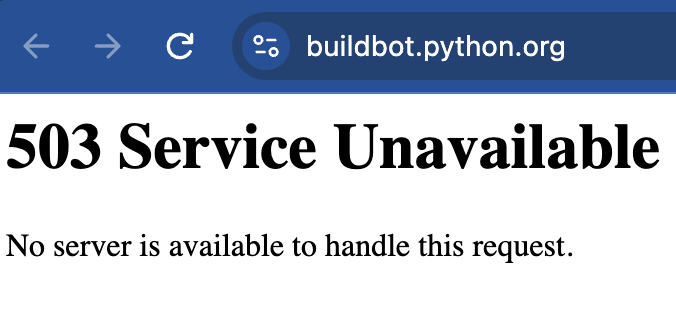

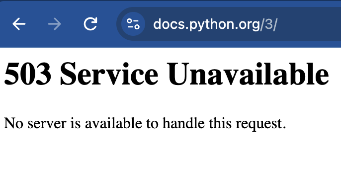

<small>[#Python](https://mastodon.social/tags/Python)
[#Python315](https://mastodon.social/tags/Python315)<br>
[_Thu, Oct 1, 2026, 14:19 EEST_](https://mastodon.social/@hugovk/117365378328527529)</small>

## Red

The US woke up and they're [both back up](https://github.com/python/psf-salt/pull/657)!

Now, there's [one tier 1 failure to check](https://buildbot.python.org/release-status).

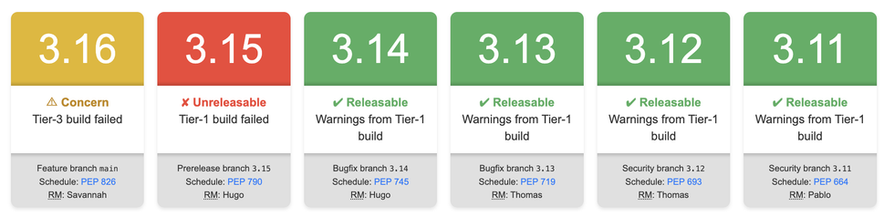

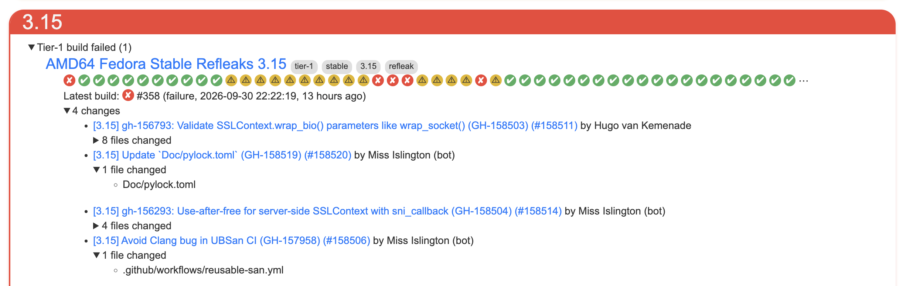

<small>[#Python](https://mastodon.social/tags/Python)
[#Python315](https://mastodon.social/tags/Python315)
[#release](https://mastodon.social/tags/release)<br>
[_Thu, Oct 1, 2026, 14:22 EEST_](https://mastodon.social/@hugovk/117365389908140888)</small>

## Flaky

```
RuntimeError: join took too long: <Process name='Process-2107' pid=2290504 parent=2276730 started daemon>
```

Looks like a [flaky test](https://buildbot.python.org/#/builders/2047/builds/358), and
[python/cpython#157184](https://github.com/python/cpython/issues/157184) has a fix to
increase a timeout. Will try
[restarting](https://buildbot.python.org/#/builders/2047/builds/359) for now.

<small>[#Python](https://mastodon.social/tags/Python)
[#Python315](https://mastodon.social/tags/Python315)
[#release](https://mastodon.social/tags/release)<br>
[_Thu, Oct 1, 2026, 14:25 EEST_](https://mastodon.social/@hugovk/117365404671635296)</small>

## Green

That passed, the
[buildbots are back to green](https://buildbot.python.org/release-status) ✅️

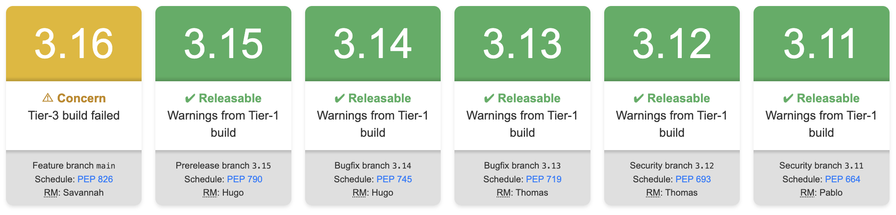

Next, issues/PRs with
[release-blocker label](https://github.com/python/cpython/labels/release-blocker).

One is a straightforward docs update, I marked as blocker so I don't forget, to change
future tense to present.

Then three last-minute lazy import blockers that need a closer look.

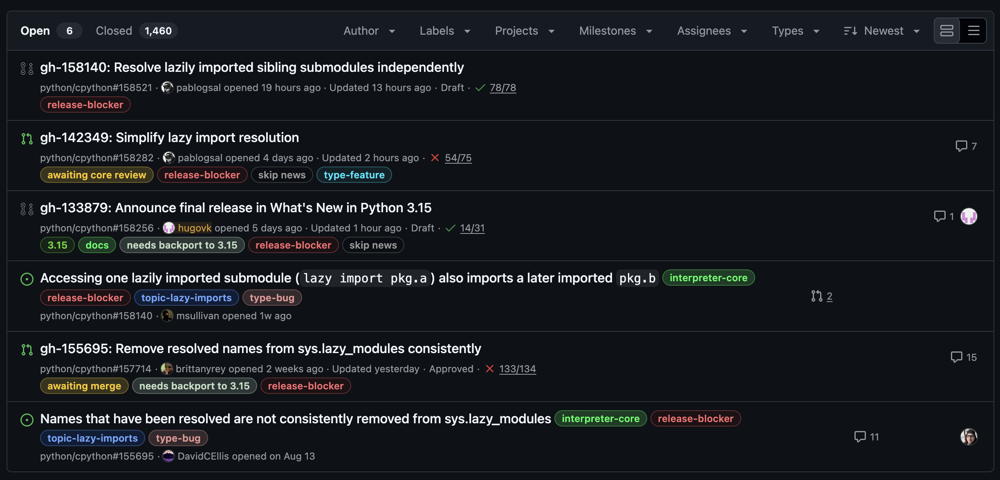

<small>[#Python](https://mastodon.social/tags/Python)
[#Python315](https://mastodon.social/tags/Python315)
[#release](https://mastodon.social/tags/release)<br>
[_Thu, Oct 1, 2026, 15:11 EEST_](https://mastodon.social/@hugovk/117365585932571822)</small>

## Traditional surprise rc3

Following recent tradition, I’m going to add a
[surprise third release candidate](https://discuss.python.org/t/python-3-15-following-tradition-lets-have-a-surprise-rc3/109313?u=hugovk)!

It makes sense to include the last-minute lazy-import fixes in 3.15.0 final.

It also makes sense to give time to test them properly, so today’s planned 3.15.0 final
is postponed, and I’m going to release a 3.15.0rc3 tomorrow, assuming everything is in
place.

And then 3.15.0 final will follow about week later. Exact date to be announced.

We’re nearly there! 🤞

<small>[#Python](https://mastodon.social/tags/Python)
[#Python315](https://mastodon.social/tags/Python315)
[#release](https://mastodon.social/tags/release)<br>
[_Fri, Oct 2, 2026, 00:49 EEST_](https://mastodon.social/@hugovk/117367858694300126)</small>

## Missing backport

The three lazy blockers are finally merged into `main`, two have been backported to
`3.15`, but wait, [the third failed](https://github.com/python/cpython/pull/158613),
because it depends on some tests not yet backported.

Okay, [backport created](https://github.com/python/cpython/pull/158614), merge conflict
fixed, CI is now spinning, and automerge enabled. That'll merge in about 15 mins, then
we can update it into the last blocker PR, that should merge about 30 mins later, and
rc3 can begin!

<small>[#Python](https://mastodon.social/tags/Python)
[#Python315](https://mastodon.social/tags/Python315)
[#release](https://mastodon.social/tags/release)<br>
[_Fri, Oct 2, 2026, 20:58 EEST_](https://mastodon.social/@hugovk/117372609147481775)</small>

## rc3

Get yer
[rc3 here!](https://discuss.python.org/t/python-3-15-0-candidate-3-is-here/109327?u=hugovk)

You know the drill: please test and report bugs!

Library maintainers, join the Cool Testers' Club 😎 and
[add 3.15 to your test matrix](https://hugovk.dev/blog/2026/help-test-python-315/).

Python 3.15.0 final planned for 2026-10-09.

<small>[#Python](https://mastodon.social/tags/Python)
[#Python315](https://mastodon.social/tags/Python315)
[#release](https://mastodon.social/tags/release)<br>
[_Sat, Oct 3, 2026, 00:14 EEST_](https://mastodon.social/@hugovk/117373382807529332)</small>

## Python 3.15.0 release day (second attempt)!

✅️ [Release date updated](https://github.com/python/cpython/pull/159053) in What's New
in Python 3.15

✅️ No [release blockers](https://github.com/python/cpython/labels/release-blocker)

✅️ No [deferred blockers](https://github.com/python/cpython/labels/deferred-blocker)

✅️ [Buildbots](https://buildbot.python.org/release-status) all green

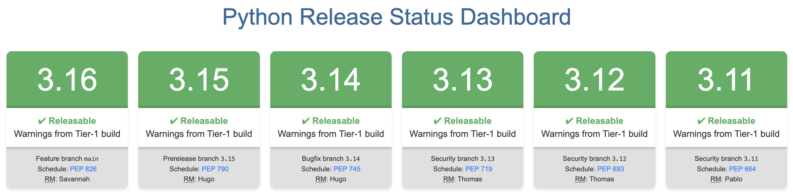

<small>[#Python](https://mastodon.social/tags/Python)
[#Python315](https://mastodon.social/tags/Python315)
[#release](https://mastodon.social/tags/release)<br>
[_Fri, Oct 9, 2026, 13:03 EEST_](https://mastodon.social/@hugovk/117410381067772845)</small>

## Cooldowns

Pydantic finally added support for Python 3.15 yesterday, and aiohttp on Monday, so I
_could_ use Python 3.15 rc3 to run the release scripts and release Python 3.15.0 final!

But... I'm going to respect our seven-day cooldown, and stick with 3.14.

You also
[use cooldowns for your dependencies](https://blog.yossarian.net/2025/11/21/We-should-all-be-using-dependency-cooldowns),
right?

<small>[#Python](https://mastodon.social/tags/Python)
[#Python315](https://mastodon.social/tags/Python315)
[#release](https://mastodon.social/tags/release)<br>
[_Fri, Oct 9, 2026, 13:12 EEST_](https://mastodon.social/@hugovk/117410412765558455)</small>

## blurb bug

Pushing the big launch button:

```sh
.venv/bin/python run_release.py --repository ../cpython --ssh-user hugovk --release 3.15.0
```

... and immediately ran into a bug with our changelog tool `blurb`, because we've had no
new NEWS fragments since rc3 :)

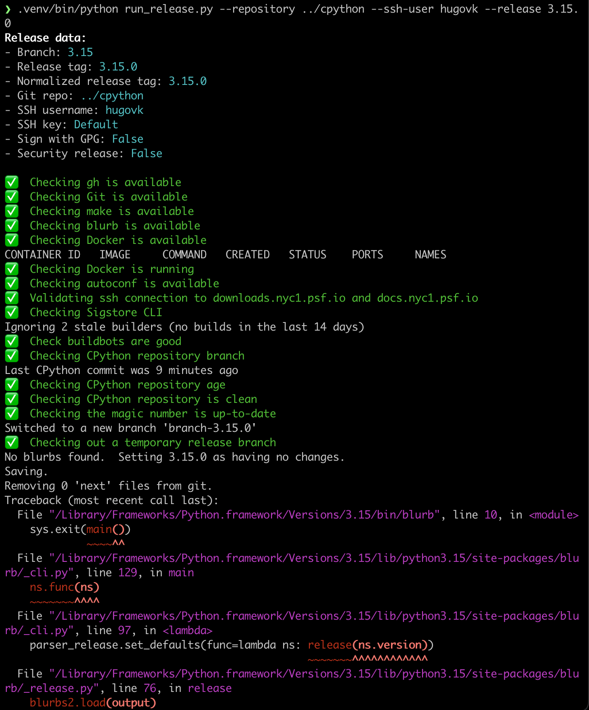
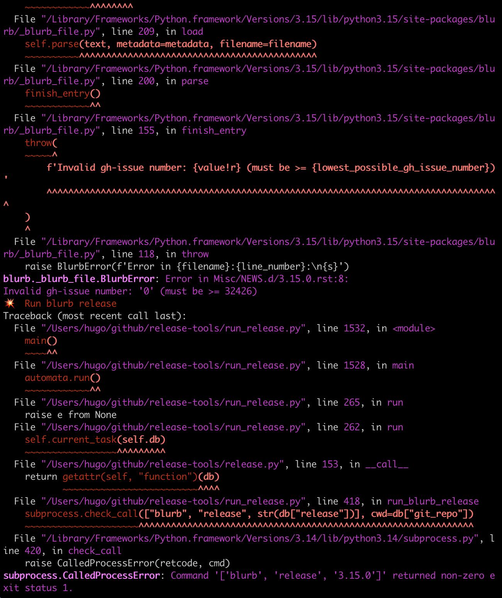

This needs a fix in blurb, a new PyPI release, and then the docs lockfile regenerated
and backported to 3.15.

Fix PR: [python/blurb#92](https://github.com/python/blurb/pull/92)

<small>[#Python](https://mastodon.social/tags/Python)
[#Python315](https://mastodon.social/tags/Python315)
[#release](https://mastodon.social/tags/release)<br>
[_Fri, Oct 9, 2026, 13:43 EEST_](https://mastodon.social/@hugovk/117410536496169713)</small>

## blurb fix

OK, merged and released (really easy using
[Trusted Publishing](https://docs.pypi.org/trusted-publishers/)), lockfile
[updated](https://github.com/python/cpython/pull/159058) and
[backported](https://github.com/python/cpython/pull/159060).

Restarted the release and that's better now.

A temporary branch and tag has been pushed to my fork, and I need to verify the
[release commit](https://github.com/hugovk/cpython/commit/d220409a13b77de7a6c30abe16ea90db01528edc)
does not contain any unexpected changes.

All looks good. Next to start the installer and artifact builds.

<small>[#Python](https://mastodon.social/tags/Python)
[#Python315](https://mastodon.social/tags/Python315)
[#release](https://mastodon.social/tags/release)<br>
[_Fri, Oct 9, 2026, 14:21 EEST_](https://mastodon.social/@hugovk/117410685206925439)</small>

## Installers

The
[release artifact build failed](https://github.com/python/release-tools/actions/runs/37922985653/job/113795259513),
need to bump blurb in that lockfile too.

Like this: [python/release-tools#451](https://github.com/python/release-tools/pull/451)

Now
[restarted that workflow](https://github.com/python/release-tools/actions/runs/37925506436)
with the existing CPython tag, no need for retag.

This builds source+docs tarballs and Android+iOS artifacts. Takes ~30 mins.

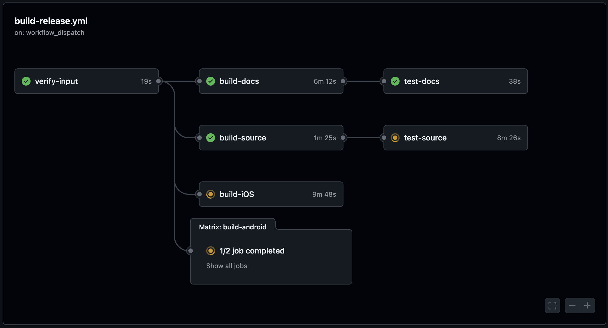

Ned Deily has started the macOS installer builds. And I've started the
[Windows installer builds](https://dev.azure.com/Python/cpython/_build/results?buildId=175636&view=results),
takes ~2 hours.

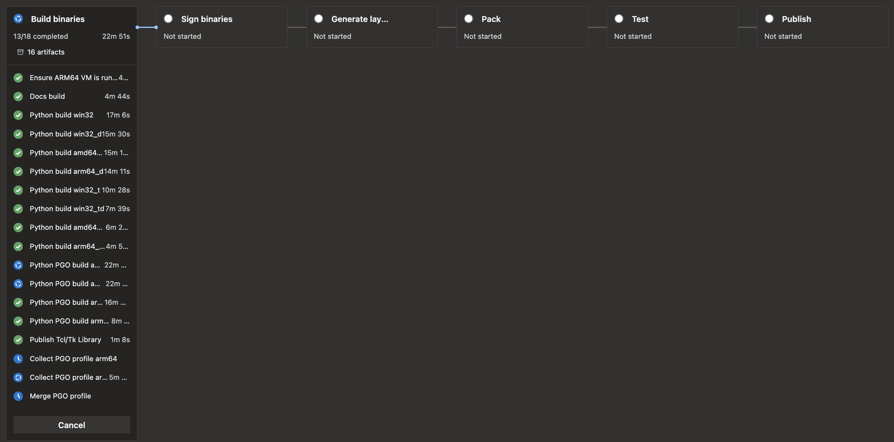

<small>[#Python](https://mastodon.social/tags/Python)
[#Python315](https://mastodon.social/tags/Python315)
[#release](https://mastodon.social/tags/release)<br>
[_Fri, Oct 9, 2026, 14:56 EEST_](https://mastodon.social/@hugovk/117410824836402022)</small>

## SBOM

In the meantime, the GitHub Actions build has finished, SBOMs created and some things
uploaded.

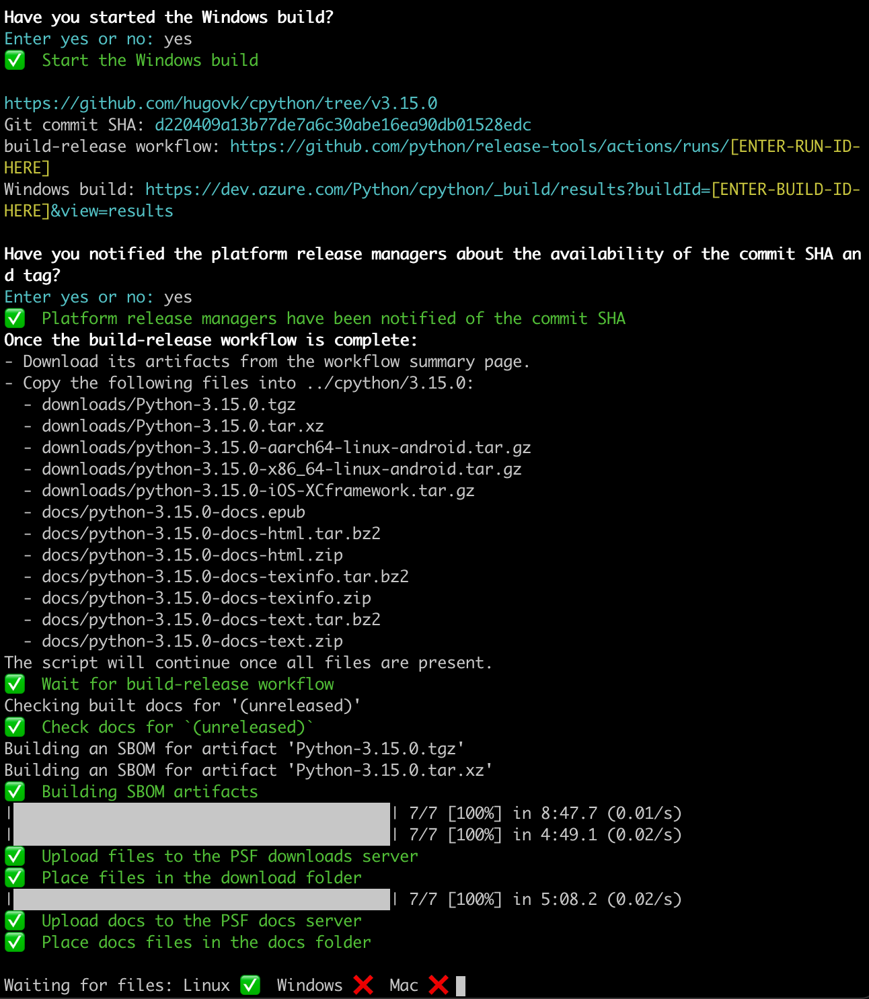

The Windows process has paused a couple of times, awaiting button clicks to approve
signing of binaries. The whole release team gets emails about this, so no sneaking out
signed releases. 🥷

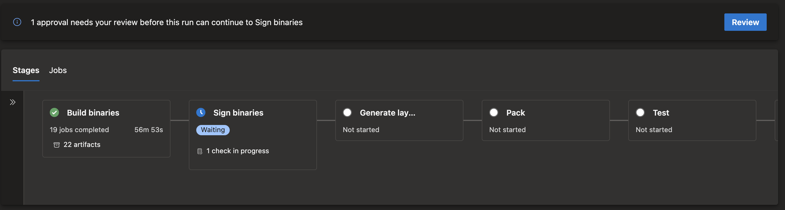

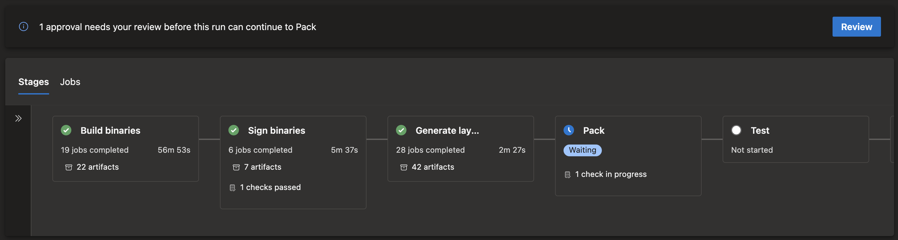

<small>[#Python](https://mastodon.social/tags/Python)
[#Python315](https://mastodon.social/tags/Python315)
[#release](https://mastodon.social/tags/release)<br>
[_Fri, Oct 9, 2026, 16:04 EEST_](https://mastodon.social/@hugovk/117411092679614029)</small>

## Nearly there

Windows complete, tags pushed upstream, Sigstore signing done, adding files to
python.org... nearly there...

<small>[#Python](https://mastodon.social/tags/Python)
[#Python315](https://mastodon.social/tags/Python315)
[#release](https://mastodon.social/tags/release)<br>
[_Fri, Oct 9, 2026, 17:11 EEST_](https://mastodon.social/@hugovk/117411353005018777)</small>

## Out now

🐍🚀 Out now:
[Python 3.15.0 final!](https://discuss.python.org/t/python-3-15-0-final-is-here/109415?u=hugovk)

💤 Lazy imports!<br> 🧊 frozendict builtin!<br> 💂 sentinel builtin!<br> 📉 Tachyon
profiler!<br> 🖼️ Frame pointers everywhere!<br> 🛅 Unpacking in comprehensions!<br> 🗣️
UTF-8 as the default encoding!<br> 🛞 Stable ABI for free-threading!<br> 🆕 Package
startup config files!<br> ⌨️ TypedDict & TypeForm!<br> 🐎 Faster JIT!<br> 🎨 More
colour!<br> 🚌 & more!

Huge thanks to the
[Sovereign Tech Agency](https://www.sovereign.tech/programs/fellowship) supporting my
work as release manager and enabling another smooth release!

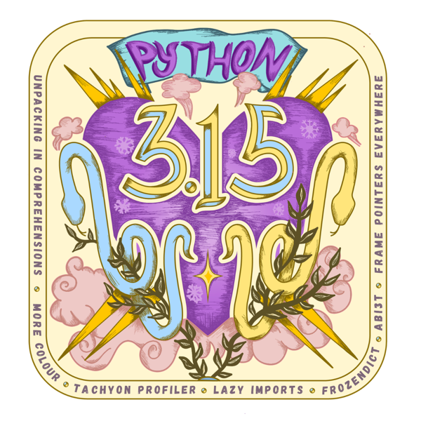

<small>[#Python](https://mastodon.social/tags/Python)
[#Python315](https://mastodon.social/tags/Python315)
[#CPython](https://mastodon.social/tags/CPython)
[#release](https://mastodon.social/tags/release)<br>
[_Fri, Oct 9, 2026, 17:23 EEST_](https://mastodon.social/@hugovk/117411399858939022)</small>

## It's not over yet!

I [updated PEP 790](https://github.com/python/peps/pull/5164), which also updates the
PEPs API, which is used to point the docs at /3/ to 3.15, kicked off a docs build:
[docs.python.org/3/](https://docs.python.org/3/)

Unpin [one toot](https://mastodon.social/@hugovk/115333348041057866) and pin
[another](https://mastodon.social/@hugovk/117411399858939022) to my profile.

(3.14 might not be the newest, but we can still celebrate with pie!)

And then unlock the 3.15 branch so the core team can start merging
[185 PRs that didn't get in during RC](https://github.com/python/cpython/pulls?q=is%3Aopen+is%3Apr+base%3A3.15).

<small>[#Python](https://mastodon.social/tags/Python)
[#Python315](https://mastodon.social/tags/Python315)
[#release](https://mastodon.social/tags/release)<br>
[_Fri, Oct 9, 2026, 18:27 EEST_](https://mastodon.social/@hugovk/117411652929387507)</small>

## Also

✅️ [update 3.15 label](https://github.com/python/cpython/labels)<br> ✅️ rebuild devguide
to update: [devguide.python.org/versions/](https://devguide.python.org/versions/)<br> ✅️
unlock 3.15 branch

And I think that's it!

Hey, [@savannah](https://fosstodon.org/@savannah), you're up next with the
[first 3.16 alpha on Tuesday](https://hugovk.dev/next-release/)! 🚀

<small>[#Python](https://mastodon.social/tags/Python)
[#Python315](https://mastodon.social/tags/Python315)
[#Python316](https://mastodon.social/tags/Python316)
[#release](https://mastodon.social/tags/release)<br>
[_Fri, Oct 9, 2026, 18:58 EEST_](https://mastodon.social/@hugovk/117411775424580934)</small>
